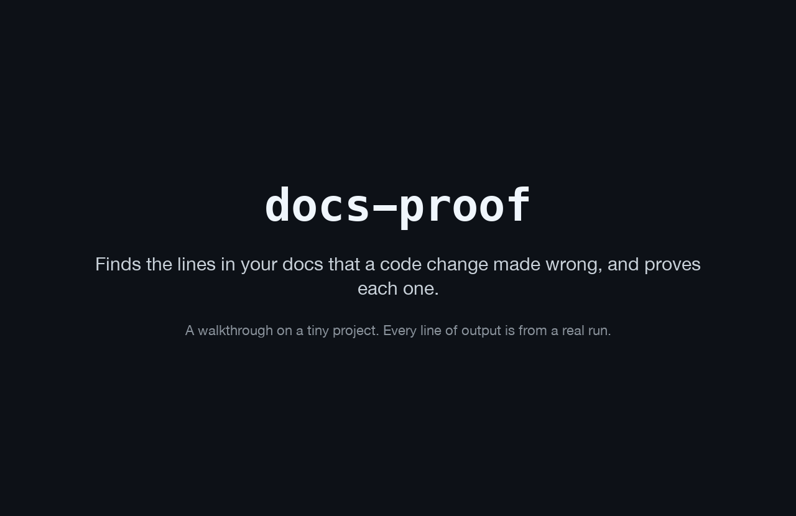

# A walkthrough on a tiny project

Generated by `scripts/walkthrough.py`. Don't edit by hand.



New to docs-proof? Here it is on a tiny made-up project, one step at a time. The script makes the project in a temporary folder and runs every command shown, so all the output here and in the GIF above is from a real run (`docs-proof` runs as `python -P -m docsproof`, the same program).

## 1. A tiny Python project

Its code has one option, `--limit`, and two docs mention it.

````console
$ cat tiny/cli.py
import argparse


def main(argv=None):
    parser = argparse.ArgumentParser()
    parser.add_argument("--limit", type=int, default=10, help="show at most N items")
    return parser.parse_args(argv)
$ cat README.md
# tiny

Use `--limit` to cap the list (default: 10).
$ cat docs/usage.md
Show three items:

```console
$ tiny --limit 3
```
````

## 2. A code change

Someone renames `--limit` to `--cap`, and nobody updates the docs.

```console
$ git diff
diff --git a/tiny/cli.py b/tiny/cli.py
index c0e17b4..0f7be58 100644
--- a/tiny/cli.py
+++ b/tiny/cli.py
@@ -3,5 +3,5 @@ import argparse
 
 def main(argv=None):
     parser = argparse.ArgumentParser()
-    parser.add_argument("--limit", type=int, default=10, help="show at most N items")
+    parser.add_argument("--cap", type=int, default=10, help="show at most N items")
     return parser.parse_args(argv)
```

## 3. Run docs-proof

It compares the code before and after the change, then reads the docs.

```console
$ docs-proof
docs-proof: 2 doc lines the change made wrong (main at a78c003 to the working tree)

README.md:3
    Use `--limit` to cap the list (default: 10).
  why: --limit was at tiny/cli.py:6 before the change and is gone
  fix: Use `--cap` to cap the list (default: 10).

docs/usage.md:4
    $ tiny --limit 3
  why: --limit was at tiny/cli.py:6 before the change and is gone
  why: `tiny` declares no --limit option in the code
  fix: $ tiny --cap 3

2 fixes suggested. Save them with --patch FILE, or make them with --apply (it asks first).
```

- First, the doc line the change made wrong: `README.md:3`.
- Then the proof: `--limit` was in the code before, and now it's gone.
- Then a fix: the new name, where the old one was.
- A command in the docs gets a second proof: `tiny` no longer has a `--limit` option.
- It changed nothing. The fixes are only suggestions until you say yes.

## 4. Save the fixes

`--patch` writes them to a file, so you can read them before anything changes.

```console
$ docs-proof --patch fixes.patch
docs-proof: 2 doc lines the change made wrong (main at a78c003 to the working tree)

README.md:3
    Use `--limit` to cap the list (default: 10).
  why: --limit was at tiny/cli.py:6 before the change and is gone
  fix: Use `--cap` to cap the list (default: 10).

docs/usage.md:4
    $ tiny --limit 3
  why: --limit was at tiny/cli.py:6 before the change and is gone
  why: `tiny` declares no --limit option in the code
  fix: $ tiny --cap 3

2 fixes suggested.
docs-proof: wrote 2 fixes to fixes.patch; make them with `git apply fixes.patch` in the project's top folder
```

- The same findings, and now the fixes are in `fixes.patch`.

## 5. Read the patch, then apply it

The patch is plain text, and `git apply` makes the changes.

````console
$ cat fixes.patch
--- a/README.md
+++ b/README.md
@@ -1,3 +1,3 @@
 # tiny
 
-Use `--limit` to cap the list (default: 10).
+Use `--cap` to cap the list (default: 10).
--- a/docs/usage.md
+++ b/docs/usage.md
@@ -1,5 +1,5 @@
 Show three items:
 
 ```console
-$ tiny --limit 3
+$ tiny --cap 3
 ```
$ git apply fixes.patch
````

## 6. Check again

Nothing is left to fix, so it exits with status 0. Earlier it exited with 1, which fails a CI check.

```console
$ docs-proof
docs-proof: no doc line found that the change made wrong (main at a78c003 to the working tree). It checks the names the change removed, the options documented commands use, and the values it changed.
```

## 7. Changed values too

Starting again from the first version, the default of `--limit` goes from 10 to 20.

```console
$ docs-proof
docs-proof: 1 doc line the change made wrong (main at a78c003 to the working tree)

README.md:3
    Use `--limit` to cap the list (default: 10).
  why: The default of the option --limit changed from 10 to 20. The code after the change (tiny/cli.py, line 6): `parser.add_argument("--limit", type=int, default=20, help="show at most N items")`
  fix: Use `--limit` to cap the list (default: 20).

1 fix suggested. Save it with --patch FILE, or make it with --apply (it asks first).
```

- The proof quotes the code line with the new default, and the fix shows the new value.

## Three ways to use it

- **In a terminal:** the `docs-proof` command. It uses no AI unless you ask, and sends nothing anywhere.
- **On every pull request:** the GitHub Action lists each flagged line, its proof, and its fix in the job summary.
- **In AI assistants:** the MCP server gives Claude Code and other assistants the same check, as two read-only tools.

How well it works, measured on real open-source projects, is in [the README](../README.md).
